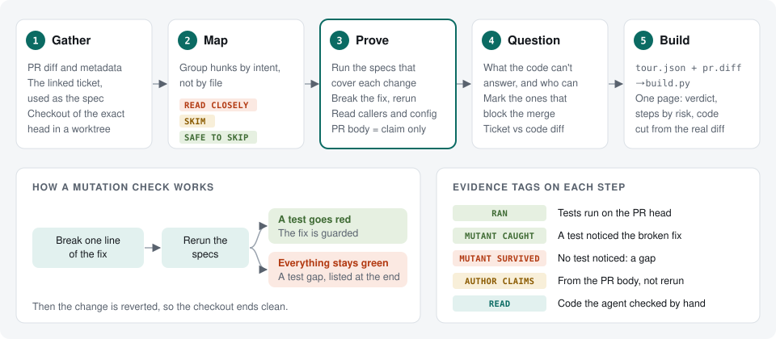
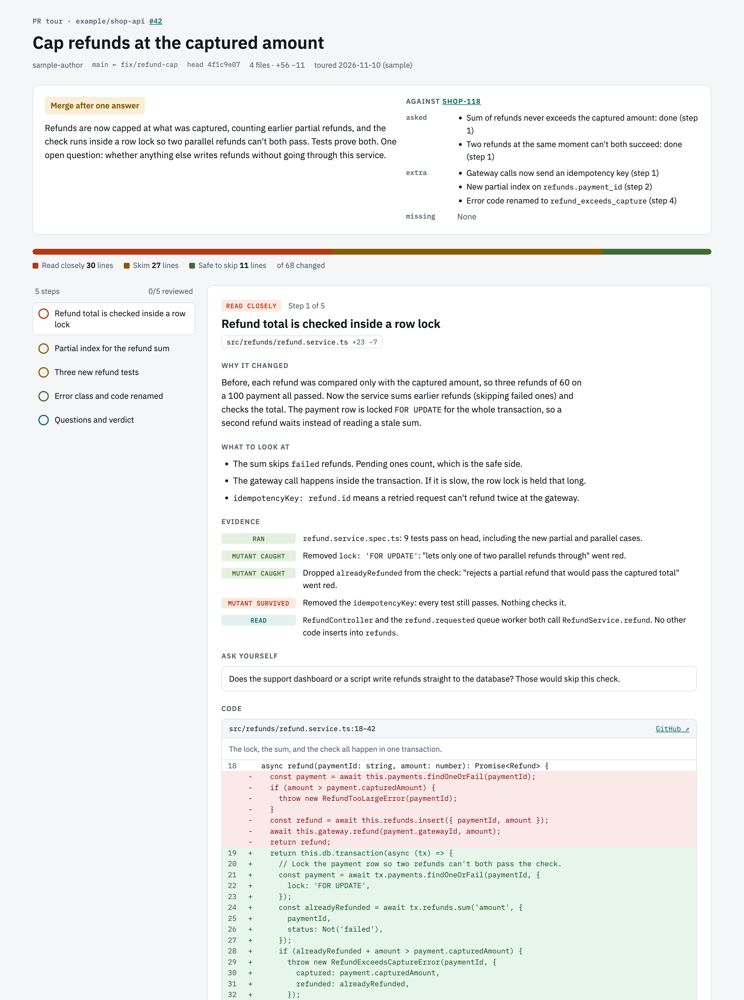
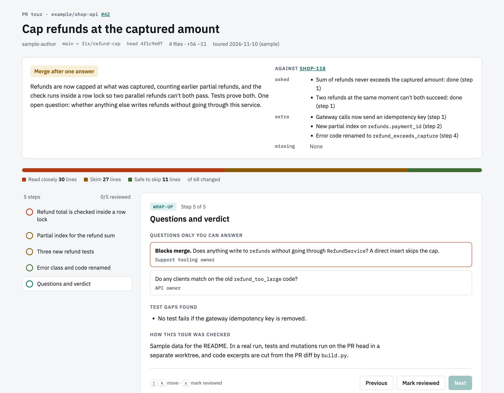

# skills

Agent skills I use with Claude Code. Each folder is one skill: a `SKILL.md` plus any files it needs.

| Skill | What it does |
|---|---|
| [pr-tour](#pr-tour) | Turns a PR into a guided review page. Changes are ordered by risk, and each claim is tied to evidence the agent produced itself: tests it ran, mutations it made, code it read. |

## pr-tour

Reviewing an AI-written PR has two costs: there is a lot of code to read, and the PR's own story is hard to trust. `pr-tour` cuts the reading to the risky changes and swaps trust for proof. The agent runs the tests on the PR head, breaks the fix on purpose to see whether any test notices, and labels every claim with how it was checked.

### How it works



### What you get

One page per PR. The top shows the verdict, what the ticket asked for against what the code does, and how many changed lines need close reading. Below that, the tour goes one step at a time, risky changes first. Each step has the evidence, the questions to ask yourself, and the code cut from the real diff.

<picture>
  <source media="(prefers-color-scheme: dark)" srcset="docs/pr-tour-dark.png">
  
</picture>

The last step collects the questions only a person can answer, marks the ones that block the merge, and lists the test gaps the mutation checks found.

<picture>
  <source media="(prefers-color-scheme: dark)" srcset="docs/pr-tour-wrap-dark.png">
  
</picture>

The screenshots use a made-up sample PR, [`pr-tour/example`](pr-tour/example). Build it yourself with:

```sh
python3 pr-tour/build.py pr-tour/example/tour.json pr-tour/example/pr.diff /tmp/pr-tour-sample.html
```

### Use it

In Claude Code, run `/pr-tour <PR link>`. Steps: [`pr-tour/SKILL.md`](pr-tour/SKILL.md).

It needs `gh` (logged in), `git` and Python 3. It runs the project's own tests, so the repo's dependencies must install locally.

## Install

```sh
git clone https://github.com/tinwritescode/skills.git ~/Coding/side/skills
ln -s ~/Coding/side/skills/pr-tour ~/.claude/skills/pr-tour
```
